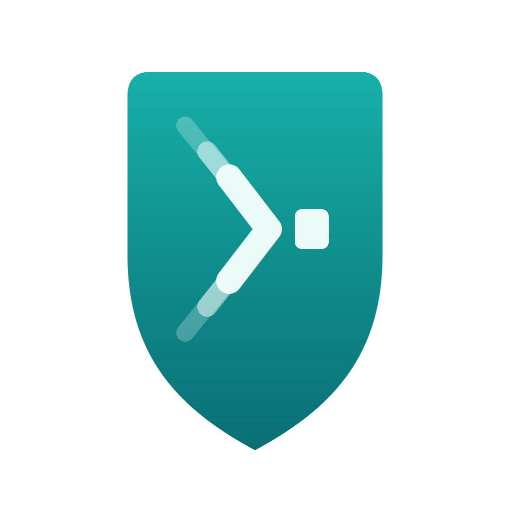
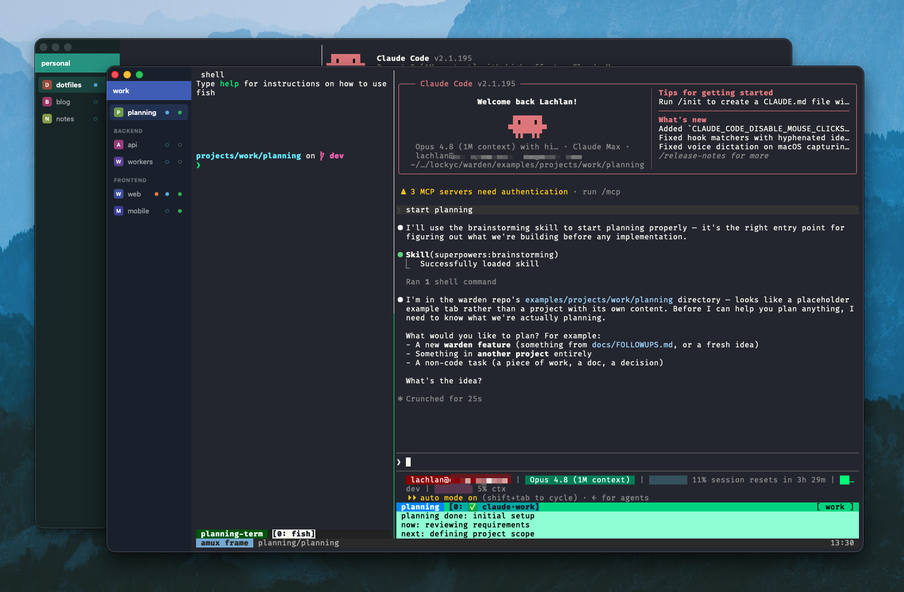

<div align="center">



# warden

**A curator for your terminals** — windows, projects, and (mostly) muxers all the way down.

[](https://github.com/Lockyc/warden/releases/latest)


[](LICENSE)



</div>

warden is a **config-driven terminal multiplexer**. One TOML file is the source of truth: it defines **windows** and the **project tabs** inside them. warden materializes itself from that config and **hot-reloads on save**. Each window carries a colour + title banner for at-a-glance identity; each tab is a real terminal opened in a working directory, running an optional command.

A tab's command can be anything: a shell, a TUI, a build watcher, an agent launcher.

It was built around one workflow: I pair each tab with [**agentmux**](https://github.com/lockyc/agentmux) (`amux`), a tmux-based agent launcher — so the stack nests `warden → agentmux → tmux` (warden itself embedding [libghostty](https://github.com/ghostty-org/ghostty) as its terminal surfaces). A multiplexer for a multiplexer for a multiplexer; it's turtles the rest of the way down.

macOS only.

## Features

- **A window per `[[window]]`** — native macOS windows, each with a colour + title banner, a curator-style draggable sidebar, and the terminal under an overlay titlebar. The **Window** menu lists every configured window — raise an open one or reopen one you've closed (**⌘⇧T** reopens the last closed).
- **Persistent, not last-window-quit** — warden opens the windows you mark `open_on_start` (default all) and shows a **home surface** when none are open, listing every configured window so you can raise or reopen one with a click. Scripts open one by title: `open 'warden://open?window=work'` launches warden if needed and opens (or focuses) that window. It's a persistent app: closing the last window never quits it — **⌘Q** does.
- **Project tabs** — each tab is a real terminal in a working directory. `load_on_open` tabs spawn at launch and keep running; the rest spawn lazily on first focus — or, with `remember_tabs`, come back loaded if they were open when you quit. Tabs can be **grouped** into labelled sidebar sections.
- **Project trees** — point a `[[window.root]]` at a directory (e.g. `~/Developer`) and warden auto-discovers every git project under it, rendering them as a collapsible tree of tabs — no per-project config needed. Set `probe`/`kill`/`suspend` on the root (see the session-presence probes below) for a session dot on every discovered project.
- **Live hot-reload** — edit the config and windows and tabs are added, removed, recoloured, and re-sectioned live on save. A missing config offers to create a starter one and an invalid one shows the error, both on the **home surface**; a parse error mid-edit instead keeps the last-good windows up behind an error banner. The **Config** menu opens the config file in your default editor or reveals it in Finder, so you needn't remember its path.
- **Tab-row affordances** — a letter/colour tile and a **live/cold dot** (filled when the terminal is spawned, hollow when cold). Hover a live dot for a ✕ that **unloads** the tab; it respawns a fresh shell on next focus.
- **Pop-out tabs** — pop the active tab into its own banner-only window with **⌘⇧O** (or hover the row's letter tile and click its pop-out icon). It's **session-preserving**: the live terminal, its scrollback, and the running process move across untouched — no restart. Closing the popped-out window returns the tab to where it came from (reopening its origin window first if you'd closed it), and the pop-in icon on its sidebar tile brings it back. A popped-out window remembers the size and position you last gave it, so a tab you pop out often reopens where you left it. A split tab pops out with both panes, their sides and the divider ratio intact, and its divider drags within the same limits as `split`'s `size`.
- **Splits** — a `split` table (global, per-window, per-root, or per-tab) opens a tab already split, second pane on either side, at a declared size, running a declared command beside the tab's own. A tab with no config split still gets one at runtime with **⌘D** (or Tab ▸ Split). Either way you get a thin draggable divider between the two terminals; to close a split, type `exit` in the second shell. A runtime split — and its ratio — is remembered per tab across restarts; a config split's dragged ratio holds only until the tab's terminals relaunch (unload, hot-reload, or app restart), then it snaps back to the declared size. **⌘W** and **⌘⇧O** always act on the whole tab, not just the focused pane: unloading drops both terminals, popping out takes both with it.
- **Live terminal affordances** — URLs and OSC 8 hyperlinks in a terminal are **clickable**: hold **⌘** and hover one for a hand cursor, **⌘-click** to open it (under tmux with `mouse on`, **shift-⌘**). Links are **screened first**: web and mail links open directly, a custom-scheme link asks before launching its handler app, and a target that could run code (an app, a script, an executable file) or hides invisible characters is refused, with a **Copy Link** option. And when a tab's process exits (the shell quits, an agent finishes), the tab goes **cold** — the dot empties and the row respawns a fresh shell on next focus.
- **Notifications** — a background tab that rings the bell or emits a desktop-notification escape (OSC 9 / OSC 777) gets an amber badge, and a desktop notification additionally raises a macOS banner; the badge clears on focus. [agentmux](https://github.com/lockyc/agentmux)'s Claude hooks notify through this.
- **Session-presence probes** — a per-tab `probe` command drives a three-state dot from its exit code: cyan on exit 0 (live), a ghost on exit 3 (crashed but restorable), hollow otherwise — independent of whether warden's own terminal surface is loaded (details below).
- **Sidebar search** — the field above the tab list narrows it as you type, matching tab titles, folder paths and group names (folders open to show matches). **⌘⇧F** jumps into it from a terminal; **↑**/**↓** pick a match, **Enter** opens it, **Esc** clears the search and returns you to the terminal. Clicking a match opens it and keeps the search focused, so you can keep narrowing.
- **Keyboard navigation** (the **Tab** menu) — **⌘⇧[** / **⌘⇧]** cycle the previous/next *loaded* tab (cold tabs are skipped) and **⌘1–⌘9** jump to a position; **Tab ▸ Cycle Tabs with ⌘1/⌘2** (or `tab_digit_keys = "cycle"`) makes **⌘1** / **⌘2** cycle instead (jumps shift to **⌘3–⌘9**). **⌘W** unloads the active tab, **⌘⇧W** closes the window, and **⌘⇧O** pops the active tab into its own window (session-preserving; see above). **⌘⇧S** suspends the active tab's session and **⌘⇧K** terminates it — the first ⌘⇧K arms the tab's confirm row, a second one within 4s confirms.
- **Rex sessions** — set `server = "local"` (or a host label from Rex's host list — remote servers are untested so far, see [`docs/FOLLOWUPS.md`](docs/FOLLOWUPS.md)) and a tab's terminals live in sessions on a Rex server — Superlogical's server-side terminal multiplexer, currently an invite-only beta you need installed. ⌘W, closing the window and quitting warden only detach: reopening the tab shows the same live screen, and the session is reachable from Rex's other clients too. The terminal takes the size of whichever device you last typed in. ☠ ends the sessions; the dot shows whether they exist, and opening the tab starts them; warden starts the local Rex server when a tab needs it. Sessions no tab claims, on every Rex server warden is connected to (at launch, those your tabs name and any a past session was made on), are listed under `Rex · <server>` in each window with a Rex tab, so none is hidden. A Rex tab's dot and ☠ come from Rex, so its `probe` and `kill` aren't run. Tabs without `server` stay plain terminals.
- **Agent tabs** — a Rex tab's main pane lists its agents in a column down its right edge, one per Rex window, so a window opened in Rex.app or on the phone shows up too. **+ New tab** (**⌘T**) starts another agent with the tab's `cmd`; each row shows its agent's status and title, renames on double-click, and drags into named groups that fold. An agent needing you while its tab is hidden badges the project's row and raises a banner.
- **Sleep and wake** — from a row's **⋯** (or right-click), **Sleep** (**⌥⌘S**) closes an agent and keeps it in the list; selecting it again resumes its conversation (set `resume` to resume through a wrapper — see *Every option*). **Close** moves it to the **Closed** fold, and **⌘⇧T** reopens the last one closed. After quitting warden or Rex, a project's agents come back asleep, and opening the project wakes the one you had selected. **Tab ▸ Sleep Server** sleeps every agent on a Rex server on this Mac and stops it, naming first anything that can't come back. Sleep needs the agent hook that `/warden:install` wires.
- **CLI** — `warden validate` prints the resolved window/tab tree and warnings; `warden fmt` formats a config in warden's house TOML style.

To wire the session-presence dot — pairing with [agentmux](https://github.com/lockyc/agentmux) — set a tab's `probe` to a session check:

```toml
probe = '"$HOME/.agentmux/bin/amux" --probe'
```

so the dot shows whether its amux session is alive: cyan while the amux session is up, a ghost when it's gone but restorable. `probe_interval` sets the idle poll in seconds (default 5; `0` probes only on events such as tab focus or hot-reload); probes also run in quick bursts after each event, so keep the probe command fast. Details: [docs/probing.md](docs/probing.md). Name amux by **absolute path** — a Finder/Dock launch doesn't have your shell's PATH. Not using agentmux? Point `probe` at any check that exits 0 when your session exists.

A tab's optional `kill` and `suspend` commands end the session the dot represents: click the cyan dot once to arm it, then pick **☠ destroy** (runs `kill`) or **⏻ suspend** (runs `suspend`) — either way the command runs fire-and-forget and the tab unloads. With agentmux, set `kill = '"$HOME/.agentmux/bin/amux" --kill'` and `suspend = '"$HOME/.agentmux/bin/amux" --suspend'` (cwd = the tab dir): both tear down the **whole amux project**. `--kill` ends the agent tabs for good; `--suspend` keeps any that had a conversation restorable, so the dot turns to a ghost and reopening the tab offers them back in amux's restore picker. The dot controls need `probe`; ⌘⇧K / ⌘⇧S run `kill` / `suspend` on any tab.

The dot works in reverse too: when the probe reports the session **gone** on a tab whose terminal is still live — hollow or ghost alike — the same dot becomes a one-click **start**: warden types the tab's `cmd` into the existing shell, so a dead or crashed agent session restarts (or restores) in place — scrollback preserved, no terminal respawn.

Not yet built (see [`docs/FOLLOWUPS.md`](docs/FOLLOWUPS.md)): ad-hoc `cmd+T` / `cmd+N` tabs and windows.

## Config

`~/.config/warden/config.toml` (override with `WARDEN_CONFIG`):

```toml
shell = "fish -l"            # global default shell
format_on_save = true        # rewrite this file tidy on each clean save
density = "compact"          # condensed chrome

[[window]]                   # a native macOS window
title  = "work"
colour = "#0f8a8a"           # banner accent
width  = 1500                # initial size, px
height = 1000
cmd    = "amux"              # this window's default startup command (each tab can override)

  [[window.tab]]             # a project terminal
  title      = "myproject"   # defaults to the dir basename
  dir        = "~/code/myproject"
  load_on_open = true        # spawn at launch and keep running

  [[window.tab]]
  title = "notes"
  dir   = "~/notes"
  cmd   = ""                 # opt out: just a bare shell here

  [[window.group]]           # optional: a labelled sidebar section
  name = "services"
    [[window.group.tab]]     # same fields as [[window.tab]]
    title = "api"
    dir   = "~/code/api"

  [[window.root]]            # optional: scan a dir; every git repo under it becomes a tab
  name = "Developer"
  dir  = "~/Developer"
```

### Every option

**Global** (top of the file):

| Key | Default | What it does |
| --- | --- | --- |
| `shell` | your login shell, run as a login shell | The shell every tab spawns. Cascades. |
| `cmd` | none | Command typed into that shell on spawn. Cascades. |
| `probe` | none | Session-presence check, run per tab (cwd = the tab's dir): exit 0 ⇒ cyan dot, exit 3 ⇒ ghost (restorable), anything else ⇒ hollow. Cascades. |
| `probe_interval` | `5` | Slow-poll floor in seconds once a burst settles. `0` = event-driven only (still bursts on triggers, no steady poll). |
| `kill` | none | Session-destroy command (☠), run on the presence dot's confirm row; the tab then unloads; ⌘⇧K runs it even on a tab without `probe`. Cascades. |
| `suspend` | none | Session-suspend command (⏻, restorable), run on the presence dot's confirm row; the tab then unloads; ⌘⇧S runs it even on a tab without `probe`. Cascades. |
| `resume` | none | Program that replaces the first word of an agent tab's reported resume command, e.g. `"my-claude"` types `my-claude --resume X` instead of `claude --resume X`. Cascades; `""` opts a level out. |
| `server` | none | Keep every tab's panes in sessions on a Rex server: `"local"` or a host label. Cascades; `""` opts a level out. On a remote server `dir` is a path on that host (no `~` expansion, no existence check). A window with a Rex tab also lists, under `Rex · <server>`, the sessions no tab of yours claims on every server warden is connected to; opening one attaches it until you close it, and nothing is written to config. |
| `split` | none | Give every tab a second pane. A table: `side` (`"left"`/`"right"`, default right), `size` (the second pane's share, `0.1`–`0.9`, default `0.5`), `cmd` (typed into it; absent = bare shell). Cascades as a whole table; `false` opts a level out, `true` = the default split. |
| `format_on_save` | `false` | Rewrite this file in house style on each clean save (same formatting as `warden fmt`). |
| `density` | `"comfortable"` | Chrome sizing. `"compact"` scales type + spacing down proportionally for denser tab lists. |
| `tab_digit_keys` | `"jump"` | ⌘1–⌘9 jump to a tab position. `"cycle"` makes ⌘1 / ⌘2 cycle next/prev instead, shifting jumps to ⌘3–⌘9. |
| `sidebar_drag` | `true` | The non-interactive sidebar chrome doubles as a window-move drag handle. |
| `open_tabs_section` | `false` | Pin an **Open** section above the main list, mirroring every tab that currently has a terminal open (including one popped out into its own window). Mirrored tabs keep their row in their own group or tree, so the main list never shuffles as terminals come and go; ⌘1–⌘9 and tab cycling ignore the mirrors. The section grows to 2/5 of the window, then scrolls on its own, independent of the main list. While the section is showing, the main list below it is dimmed until you hover it. Cascades global → window. |
| `remember_tabs` | `false` | Each window comes back the way you left it: the tabs that had a terminal open respawn when it opens (their `cmd` re-runs, so `amux` reattaches), and the tab you were on is selected. Applies at launch and when you reopen a closed window. Cascades global → window. |
| `auto_update` | `true` | Check for a new release on launch and every 6h. `false` suppresses the auto-check; **Check for Updates…** still works. Takes effect at next launch. |
| `notify_debug` | `false` | Trace the notification path to `$TMPDIR/warden-notify-dbg.log` — a debug aid, read at launch (see [`docs/notifications.md`](docs/notifications.md)). |

**`[[window]]`** — one native macOS window each:

| Key | Default | What it does |
| --- | --- | --- |
| `title` | *required* | Banner text + window title; unique across the config. Changing it is destructive — the window is closed and reopened, so its terminals and saved size/position reset. |
| `colour` | neutral | Banner accent, `#rgb` or `#rrggbb`. |
| `width` / `height` | `1500` / `1000` | Initial size in px; the window's saved size/position wins after the first launch. |
| `open_on_start` | `true` | Materialize this window at launch. `false` = configured but closed — open it from the home surface or the **Window** menu, or script it with `open 'warden://open?window=<title>'`. |
| `open_tabs_section` | inherited from global | Whether THIS window's sidebar pins the **Open** section. Set it per window to show the section in a busy window and not a quiet one. |
| `remember_tabs` | inherited from global | Whether THIS window restores its loaded tabs and selection. |
| `shell` / `cmd` / `probe` / `kill` / `suspend` / `resume` / `server` / `split` | inherited from global | Per-window overrides for every tab in it. |

**`[[window.tab]]`** (and `[[window.group.tab]]`) — one project terminal each:

| Key | Default | What it does |
| --- | --- | --- |
| `dir` | *required* | Working directory the terminal opens in (`~` expanded). A dir that doesn't exist is a warning, not an error. On a remote `server` it's a path on that host, taken as written. |
| `title` | basename of `dir` | Display label. Purely cosmetic — may repeat within a window. |
| `id` | unset | Stable identity, needed only to disambiguate two tabs that share a `dir`. Otherwise the `dir` *is* the identity. |
| `load_on_open` | `false` | Spawn at launch and keep running in the background. Otherwise a tab spawns lazily on first focus. |
| `shell` / `cmd` / `probe` / `kill` / `suspend` / `resume` / `server` / `split` | inherited from the window | Per-tab overrides. |

**`[[window.group]]`** — a labelled sidebar section:

| Key | Default | What it does |
| --- | --- | --- |
| `name` | *required* | Section header. Unique within the window (one namespace shared with `[[window.root]]` names). |

**`[[window.root]]`** — a scanned projects dir; every git repo found becomes a tab:

| Key | Default | What it does |
| --- | --- | --- |
| `dir` | *required* | Dir to scan. The walk stops at each `.git` (never descends into a repo) and skips hidden dirs and symlinks. |
| `name` | basename of `dir` | Section header for the discovered tree. |
| `depth` | `6` | How deep to scan; must be ≥ 1. |
| `shell` / `cmd` / `probe` / `kill` / `suspend` / `resume` / `server` / `split` | inherited from the window | Overrides applied to every project discovered under this root. |

Three rules the tables can't carry. **`cmd` is typed *into* the shell, not exec'd** — so a shell function like [agentmux](https://github.com/lockyc/agentmux)'s `amux` resolves, and you drop back to a live prompt when it exits. **The cascading keys resolve nearest-level-wins** — a tab's value beats its window's, which beats the global one, with `""` opting a level out of an inherited value (`cmd = ""` gives you a bare shell under a global `cmd`); projects discovered under a `[[window.root]]` have no tab level, so the root takes the tab's place (root, then window, then global). `split` cascades the same way but as a **whole table** — the nearest table wins entirely, and `split = false` is its `""`. And **grouping is cosmetic** — `[[window.group]]` only sections the sidebar; loose `[[window.tab]]`s appear first in a headerless section.

Everything above hot-reloads on save, except `auto_update` and `notify_debug` (read at launch).

Full schema, validation rules, and resolution semantics: [`docs/config.md`](docs/config.md).

## Install

**Download (no build):** grab `warden-<version>-macos.zip` from the
[latest release](https://github.com/Lockyc/warden/releases/latest), unzip, and move
`warden.app` to `/Applications`. Release builds are signed with Developer ID and notarized,
so they open without a Gatekeeper block. macOS only. Agent tabs' sleep and wake also need the
agent hook, which only `/warden:install` wires.

**Guided (Claude Code):** run `/warden:install` — it checks prerequisites
(Xcode Command Line Tools, Rust, the Tauri CLI), builds warden from source, installs
it to `/Applications`, seeds your config, and wires the agent-tab hook into each Claude Code
profile's `settings.json`.

**One-liner:**

```sh
curl -fsSL https://raw.githubusercontent.com/lockyc/warden/main/install.sh | bash
```

This clones warden to `~/.warden`, builds the release bundle (`cargo tauri build`),
installs `warden.app` to `/Applications`, and seeds `~/.config/warden/config.toml`
from the starter config if you don't already have one, and copies the agent-tab hook to
`~/.local/share/warden/agent-hooks/` (wiring it into Claude Code is `/warden:install`'s step). Re-run
it any time to update (it git-pulls and rebuilds). macOS only.

Prerequisites: macOS, Xcode Command Line Tools, a Rust toolchain
([rustup](https://rustup.rs)). The installer installs the Tauri CLI itself if missing.

## Updates

warden updates itself — no reinstall. On launch, every 6 hours while open,
and via **warden ▸ Check for Updates…**, it checks GitHub for a newer release; when one exists the
sidebar shows an *Update available: v X* bar with a one-click **Update & Relaunch**.

- **Confirm-to-install** — nothing installs silently; you approve each update, and the bar's
  **×** dismisses it for the session.
- **Signed** — each update's signature is verified before it installs.
- **Opt out** with `auto_update = false` (the **Check for Updates…** menu item still works).

Releases ship a **universal binary** — one `warden.app` that runs natively on both Apple Silicon
and Intel Macs. Versions before **0.6.0** need one manual reinstall to get in-app updates.

## Build & use

With [`just`](https://github.com/casey/just) (run `just` to list recipes; `just run` launches
against [`examples/config.toml`](examples/config.toml), whose tabs point at the mock project tree
documented in [`examples/projects/README.md`](examples/projects/README.md)):

```sh
just hooks        # once per clone: enable .githooks (pre-push doc gate + active-[patch] guard)
just run          # launch the app against examples/config.toml (never touches your real config)
just validate     # validate the demo config (pass a path to validate another)
just test         # workspace tests
just fmt          # format Rust sources (cargo fmt)
just clippy       # lint (warnings as errors)
just gate         # the full pre-merge gate (no active [patch], fmt-check, clippy, tests, example-config fmt)
just build        # build the release warden.app (needs: cargo install tauri-cli --version ^2)
just install      # build, install to /Applications, and relaunch
```

A source build is ad-hoc signed; `just install` re-signs it with your *Developer ID Application* cert if one is in your keychain, which on **macOS 26** avoids slow command launches inside warden. Release signing and notarization: [`docs/releasing.md`](docs/releasing.md).

Or with cargo directly:

```sh
cargo build
cargo test
cargo run -p warden-app                                # launch the app (macOS; reads WARDEN_CONFIG or ~/.config/warden/config.toml)
cargo run -p warden-config --bin warden -- validate    # validate ~/.config/warden/config.toml
cargo run -p warden-config --bin warden -- validate path/to/config.toml
cargo run -p warden-config --bin warden -- fmt         # format ~/.config/warden/config.toml in place
cargo run -p warden-config --bin warden -- fmt path/to/config.toml
cargo run -p warden-config --bin warden -- fmt --check path/to/config.toml  # check only, no write
```

`warden validate` prints the resolved windows/tabs and any warnings; exit code 0 (ok), 1 (load/parse/validation error), 2 (usage). `warden fmt` rewrites a config in warden's house TOML style — consistent indentation, aligned `=`, section spacing (`--check` reports without writing, for a CI gate); `format_on_save = true` applies the same formatting automatically on each clean save.

## Layout

- `crates/warden-config/` — the config crate (library + `warden` CLI).
- `crates/warden-app/` — the macOS Tauri app (windows, sidebar, libghostty terminals, hot-reload).
- `crates/rex-client/` — the Rex protocol client; `crates/warden-relay/` — the helper a Rex-backed pane runs.
- `scripts/agent-hooks/` — the hook an agent runs to tell warden how to resume it.
- `assets/` — icon masters (`icon.svg`, `icon-app.svg`), rendered PNGs, the macOS `warden.icns`, and `build-icons.sh` to regenerate the rasters from the SVGs.
- `docs/FOLLOWUPS.md` — tracked list of intentionally-deferred work.

## Related projects

warden is built on three shared library crates; a source build fetches them automatically:

- **[chrome-core](https://github.com/Lockyc/chrome-core)** — the sidebar chrome (banner,
  grouped tab rows, resize drag, density tokens).
- **[config-core](https://github.com/Lockyc/config-core)** — the TOML config engine (parse,
  validate, format, hot-reload diff) behind warden's config and `warden fmt`.
- **[shell-core](https://github.com/Lockyc/shell-core)** — shared release tooling and app-shell
  runtime (window geometry, updater).

Two **sibling apps** share the same cores: [curator](https://github.com/Lockyc/curator) curates
**browser tabs** and [lector](https://github.com/Lockyc/lector) curates **local documentation
sites**, the way warden curates **terminals**.

If you want to iterate on a shared core, `just chrome-dev` builds warden against a sibling
`../chrome-core` checkout (including uncommitted edits) and `just chrome-pin` re-pins to its
pushed commit afterward; `just config-dev` / `just config-pin` and `just shell-dev` / `just shell-pin`
are the same pair for `../config-core` and `../shell-core`. Never commit an active patch — `just gate`
and a `.githooks/pre-commit` guard both refuse while one is live.

## License

MIT — see [`LICENSE`](LICENSE).

The vendored libghostty binaries (`crates/warden-app/vendor/`, and libghostty-vt in
`crates/warden-relay/vendor/`) are [Ghostty](https://github.com/ghostty-org/ghostty) compiled from an unmodified, pinned
upstream commit by [`lockyc/libghostty-build`](https://github.com/lockyc/libghostty-build)
and distributed under Ghostty's MIT license; see
[`crates/warden-app/vendor/LICENSE-ghostty`](crates/warden-app/vendor/LICENSE-ghostty)
and [`PROVENANCE.md`](crates/warden-app/vendor/PROVENANCE.md) in that directory.
